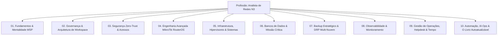

# 📖 Profissão: Analista de Redes & Engenheiro de Infraestrutura N3
### O Manual Definitivo de Operações MSP, Governança, MikroTik RouterOS, Segurança Zero-Trust e Automação

[](https://epiresonline.github.io/profissao-analista-de-redes/)
[](https://github.com/epiresonline)
[](#)
[](#)

---

## 🎯 Sobre Este Livro

Este livro é a consolidação viva e prática de **anos de operação real em ambientes de missão crítica**, redes corporativas, provedores de serviços gerenciados (**MSP/MSSP**) e gestão avançada de infraestrutura multi-tenant.

Aqui não há teoria vazia de laboratório. Cada capítulo, arquitetura, comando, script e procedimento operacional padrão (**POP**) foi concebido, testado em fogo e homologado em produção na governança de mais de **25 clientes corporativos**, englobando hospitais, clínicas de medicina diagnóstica, redes educacionais, indústrias, franquias e datacenters cloud.

---

## 👨‍💻 Autor e Responsável Técnico

| Atributo | Detalhe |
| :--- | :--- |
| **Autor & Engenheiro Responsável** | **Eduardo Pires** |
| **Cargo & Especialidade** | **Analista de Redes N3 / Engenheiro de Infraestrutura MSP** |
| **Empresa & Matriz de Operações** | **Pulse TI** (`002 - PTI - Pulse TI`) |
| **Contato / Perfil GitHub** | [@epiresonline](https://github.com/epiresonline) |
| **E-mail Operacional** | `redes@pulseti.com` |
| **Padrão de Data Adotado** | Formato Brasileiro Mandatório (`DD/MM/YYYY`) |

---

## 📚 Estrutura Completa da Obra (10 Módulos & 40 Capítulos)



### 📑 Sumário Detalhado

1. **Módulo 01: Fundamentos & Mentalidade MSP**
   - 01.1 Mentalidade MSP vs TI Tradicional: A responsabilidade de manter múltiplos ecossistemas vivos.
   - 01.2 O Papel do Analista de Redes N3: Diagnóstico profundo, postura de liderança técnica e mitigação de risco.
   - 01.3 Responsabilidade Técnica & Assinatura Mandatória de Documentações.
2. **Módulo 02: Governança & Arquitetura de Workspace**
   - 02.1 A Taxonomia Padrão Ouro: `<CODIGO> - <SIGLA> - <Nome>`.
   - 02.2 A Arquitetura Estrita em 2 Níveis (Zero Labirinto de Pastas).
   - 02.3 Padrão Brasileiro de Datas (`DD/MM/YYYY`) e Metadados Obrigatórios.
   - 02.4 Matriz Operacional Multi-Tenant: Como catalogar 25 clientes simultâneos.
3. **Módulo 03: Segurança Zero-Trust & Gestão de Acessos**
   - 03.1 Política Estrita de Credenciais (Regra 11: Zero Senhas em Texto Puro).
   - 03.2 Gestão de Cofres: KeePass corporativo e Pulse Control Web (SQLite 3 com FTS e REST).
   - 03.3 Convenções Decodificadas de Acesso: NetBird RDP/DNS, PuTTY SSH Overwrite e Winbox seguro.
   - 03.4 Bastion Hosts, Segmentação de Redes e Princípio do Menor Privilégio.
4. **Módulo 04: Engenharia Avançada MikroTik RouterOS (v6 & v7)**
   - 04.1 Hardening Homologado: Portas não-padrão, desativação de serviços inseguros e address-lists.
   - 04.2 Firewall Filter, NAT e Mangle de Produção: FastTrack bypass, proteção contra Port Scan e Brute-Force.
   - 04.3 Cloud DNS Dinâmico (`*.sn.mynetname.net`) em links sem IP fixo.
   - 04.4 VPNs Corporativas: NetBird Mesh WireGuard, WireGuard v7, SSTP com certificados, OpenVPN e EoIP+IPsec.
   - 04.5 QoS, Simple Queues, Queue Tree e Priorização de Tráfego de Voz e Aplicações Críticas.
   - 04.6 Rotinas de Backup Automatizado: Export `.rsc` limpo e binário criptografado `.backup`.
5. **Módulo 05: Infraestrutura, Hipervisores & Sistemas Operacionais**
   - 05.1 Hipervisores Corporativos: Proxmox VE, VMware ESXi e KVM em produção.
   - 05.2 Linux Server Hardening: SSH key-only, Fail2ban, UFW/iptables, logrotate e systemd.
   - 05.3 Storage Corporativo e NAS: Synology, TrueNAS, QNAP, mapeamentos SMB/NFS multi-tenant.
   - 05.4 Containers Docker & Docker-Compose: Isolamento, persistência de volumes e redes bridge.
6. **Módulo 06: Bancos de Dados Corporativos & Ambientes de Missão Crítica**
   - 06.1 PostgreSQL: Tuning de `postgresql.conf`, rotinas de vacuum, pgAdmin e dumps em formato custom `-Fc`.
   - 06.2 Oracle Database 19c & Philips TASY: Listener, tablespaces, archive logs e integrações de saúde.
   - 06.3 MySQL & MariaDB: Flags seguras de dump (`--single-transaction`), replicação e consistência InnoDB.
   - 06.4 Ambientes Médicos e Diagnósticos: PACS Optix, Mobilemed, DICOM e conformidade de guarda legal.
7. **Módulo 07: Backup Estratégico, Nuvem & Disaster Recovery (DRP)**
   - 07.1 A Regra Ouro 3-2-1-1-0 e Política de Rotação GFS (Diários, Semanais, Mensais, Anuais).
   - 07.2 Automação Multi-Nuvem com Rclone (Google Drive corporativo, AWS S3, Wasabi).
   - 07.3 Políticas de Retenção e Auditoria Automatizada de Integridade (`backup-inspector`).
   - 07.4 O Teste Mandatório de Restauração: Como estruturar e homologar o DRP.
8. **Módulo 08: Observabilidade, Monitoramento & Métricas Operacionais**
   - 08.1 Zabbix Server Enterprise: SNMP v2/v3, Zabbix Agent 2, MIBs customizadas e histerese em triggers.
   - 08.2 Beszel Hub: O Monitoramento Ultraleve moderno para servidores MSP.
   - 08.3 Grafana: Construção de Dashboards executivos e operacionais.
   - 08.4 Matriz de Severidade de Alertas e Combate à Fadiga Operacional.
9. **Módulo 09: Gestão de Operações, Helpdesk & Tempo**
   - 09.1 Gestão de Chamados no Hesk Helpdesk e APIs de Automação (Primeira Resposta Mandatória).
   - 09.2 A Regra de Ouro dos Blocos Redondos de 30 Minutos (Horários redondos `:00` / `:30`).
   - 09.3 Classificação Visual por Cores Mandatória no Google Calendar e disparo de convites.
   - 09.4 Metodologia de Criação de POPs e Runbooks N1/N2 à Prova de Falhas.
10. **Módulo 10: Automação, IA Ops & O Livro Autoatualizável**
    - 10.1 Engenharia de Prompts e IA Integrada à Operação Técnica (AIOps).
    - 10.2 Construção de Skills e Agentes Especialistas no Workspace.
    - 10.3 Sincronização Contínua entre Workspace, Wiki.js e Repositórios Git.
    - 10.4 O Mecanismo do Livro Autoatualizável: Como esta obra evolui continuamente com a operação.

---

## ⚡ Como Funciona o Motor Autoatualizável

Este repositório possui uma arquitetura viva:
1. **Script de Auditoria e Sincronização Local (`scripts/update_book.py` / `scripts/update_book.bat`):**  
   Varre a evolução do workspace, detecta novos procedimentos, valida a conformidade das regras, atualiza métricas e estatísticas no `docs/index.md` e gera um novo registro no `docs/changelog.md`.
2. **Pipeline de Integração Contínua (GitHub Actions):**  
   Ao receber um push na branch `main`, compila a documentação MkDocs e publica a versão estática atualizada diretamente no GitHub Pages.

### Executando a Atualização Manualmente

```powershell
# Em ambiente Windows PowerShell:
D:\profissao-analista-de-redes\scripts\update_book.bat
```

---

## 🚀 Como Visualizar Localmente com MkDocs

```bash
# 1. Clonar o repositório
git clone https://github.com/epiresonline/profissao-analista-de-redes.git
cd profissao-analista-de-redes

# 2. Instalar dependências
pip install -r requirements.txt

# 3. Iniciar servidor local
mkdocs serve
```

Acesse em seu navegador em `http://127.0.0.1:8000/`.

---

## 📄 Licença e Propriedade Intelectual

Todo o conteúdo deste repositório reflete as metodologias e padrões operacionais desenvolvidos por **Eduardo Pires**.  
Distribuído sob licença MIT. Sinta-se livre para estudar, aplicar em sua empresa e aprimorar as boas práticas da engenharia de redes e infraestrutura.
