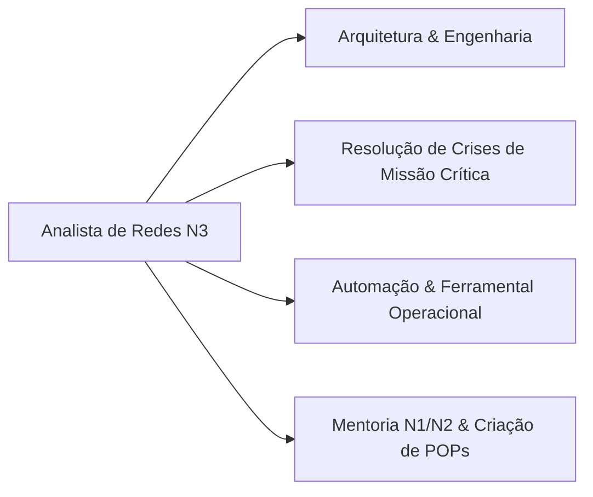

# Módulo 01 — Fundamentos & Mentalidade MSP
## 01.2 O Papel do Analista de Redes N3

O **Analista de Redes N3 (Nível 3)** representa o topo da cadeia de resolução técnica da operação. Quando um problema chega ao N3, significa que todas as soluções superficiais e procedimentos padrão falharam ou que o desafio exige redesenho de arquitetura.

### As Quatro Frentes de Atuação do N3

### 1. Arquitetura & Engenharia
- Desenho de topologias de rede seguras e escaláveis.
- Planejamento de VPNs mesh, enlaces de rádio, rotas dinâmicas (BGP/OSPF) e políticas de firewall.
- Dimensionamento de hardware, storages e hipervisores para novos clientes ou expansões.

### 2. Resolução de Crises (Troubleshooting Avançado)
- Análise de pacotes via `tcpdump` e Wireshark.
- Resolução de loops de camada 2 (STP/RSTP/MSTP) e tempestades de broadcast.
- Diagnóstico de latência, jitter, perda de pacotes e corrupção de tabelas de roteamento.
- Restauração de desastres em bancos de dados corrompidos ou storages degradados.

### 3. Automação & Ferramental
- Criação de scripts de backup automatizado e auditoria.
- Integração de sistemas via API REST (Zabbix, Beszel, Hesk, Google Calendar).
- Configuração de esteiras de sincronização e IA Ops.

### 4. Mentoria & Governança N1/N2
- O N3 **não deve reter conhecimento**. Todo incidente resolvido deve ser convertido em um Procedimento Operacional Padrão (**POP**) para que a equipe N1 e N2 seja capaz de resolver ocorrências semelhantes no futuro.
