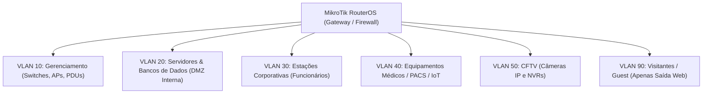

# Módulo 03 — Segurança Zero-Trust & Gestão de Acessos
## 03.4 Bastion Hosts & Segmentação de Rede

O modelo tradicional de "rede plana" (onde computadores da recepção, servidores de banco de dados e câmeras IP compartilham a mesma subnet `/24`) é inaceitável em um ambiente profissional.

### A Arquitetura de Segmentação por VLANs

Em todos os clientes com switches gerenciados e roteadores MikroTik, dividimos o tráfego nas seguintes VLANs padrão:

### Regras de Ouro de Tráfego entre VLANs
1. **Isolamento de Visitantes (VLAN 90):** Nunca pode enxergar nenhuma outra VLAN ou o IP de gerência do roteador.
2. **CFTV (VLAN 50):** Não tem acesso à Internet, exceto a porta de sincronização NTP e o streaming autorizado do NVR.
3. **Servidores (VLAN 20):** Apenas portas estritamente necessárias recebem tráfego da VLAN 30. Portas de banco de dados (5432, 1521, 3306) **só recebem conexão das VMs de aplicação**, nunca das estações dos usuários.

### O Papel do Bastion Host (Servidor de Salto)
Para administração externa segura:
- O acesso administrativo não vai diretamente para as VMs de banco.
- O engenheiro conecta primeiro via VPN NetBird ou SSH com autenticação de dois fatores (2FA) em um **Bastion Host Linux** dedicado.
- A partir do Bastion, o acesso aos bancos e hipervisores é liberado pela tabela de firewall do Proxmox ou iptables.
