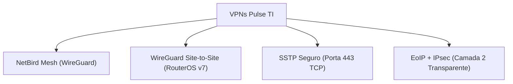

# Módulo 04 — Engenharia Avançada MikroTik RouterOS
## 04.4 VPNs Corporativas: NetBird Mesh, WireGuard v7, SSTP e EoIP

A interconexão segura entre filiais, datacenters e técnicos é uma das principais responsabilidades do Analista de Redes N3. A Pulse TI homologa quatro tecnologias principais, cada uma com seu objetivo claro:



### 1. NetBird Mesh VPN (Overlay WireGuard)
- **Caso de Uso:** Conexão zero-touch de estações de técnicos, servidores e VMs em qualquer provedor de nuvem.
- **Topologia:** Mesh ponto a ponto direto através de orquestrador central com autenticação corporativa.
- **Vantagem:** Atravessa CGNAT de operadoras de celular e fibra sem necessidade de portas abertas.

### 2. WireGuard Site-to-Site no RouterOS v7
- **Caso de Uso:** Enlace de alto desempenho e baixíssima latência entre a Matriz e Unidades Regionais (ex.: `112 - PRN Diagnósticos`).
- **Configuração no RouterOS v7:**
```routeros
# Criar interface WireGuard
/interface wireguard
add name=wg-matriz listen-port=13231 private-key="CHAVE_PRIVADA_GERADA"

# Definir IP da interface
/ip address
add address=10.250.0.1/30 interface=wg-matriz

# Adicionar Peer da Filial
/interface wireguard peers
add interface=wg-matriz public-key="CHAVE_PUBLICA_FILIAL" \\
    allowed-address=10.250.0.2/32,192.168.10.0/24 \\
    endpoint-address="filial.sn.mynetname.net" endpoint-port=13231 persistent-keepalive=25s
```

### 3. SSTP (Secure Socket Tunneling Protocol)
- **Caso de Uso:** Contingência para ambientes extremamente restritivos onde portas UDP (WireGuard) ou IPsec são bloqueadas por firewalls de terceiros.
- **Vantagem:** Trafega encapsulado em SSL/TLS padrão na porta TCP 443, passando por qualquer proxy web.

### 4. EoIP com IPsec (Ethernet over IP)
- **Caso de Uso:** Casos especiais onde matriz e filial precisam compartilhar a **mesma rede de camada 2 (mesmo domínio de broadcast)**, permitindo comunicação de softwares legados que não aceitam roteamento de pacotes.
