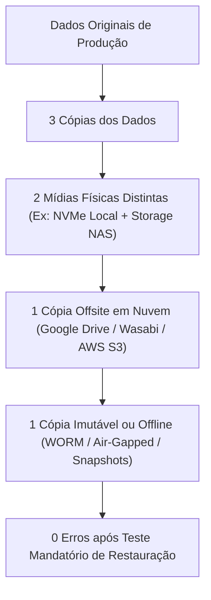

# Módulo 07 — Backup Estratégico, Nuvem & DRP
## 07.1 A Regra de Ouro 3-2-1-1-0 e Política de Rotação GFS

Na engenharia de infraestrutura da Pulse TI, "fazer backup" não é um script jogado em um pendrive. É uma política arquitetural estrita que segue a evolução máxima da consagrada regra 3-2-1.

### A Regra 3-2-1-1-0

### Política de Rotação GFS (Grandfather-Father-Son)
Para evitar que o armazenamento em nuvem estoure e manter um histórico confiável de restauração, aplicamos o ciclo GFS:
- **Son (Filho - Diário):** Backups incrementais ou diários com retenção de **7 a 14 dias**.
- **Father (Pai - Semanal):** Backups consolidados de final de semana com retenção de **4 a 5 semanas**.
- **Grandfather (Avô - Mensal):** Backups de fechamento de mês com retenção de **12 meses**.
- **Anual:** Backups históricos salvos permanentemente em armazenamento frio (Cold Storage).
