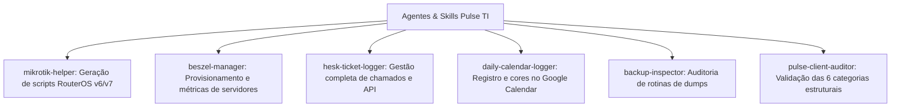

# Módulo 10 — Automação, IA Ops & O Livro Autoatualizável
## 10.2 Construção de Skills e Agentes Especialistas

No diretório `.agents/skills/`, mantemos um ecossistema de habilidades especializadas que expandem a inteligência artificial para interagir com o mundo físico da infraestrutura:

Cada skill possui sua instrução YAML de frontmatter, scripts em Python ou PowerShell e testes automatizados.
