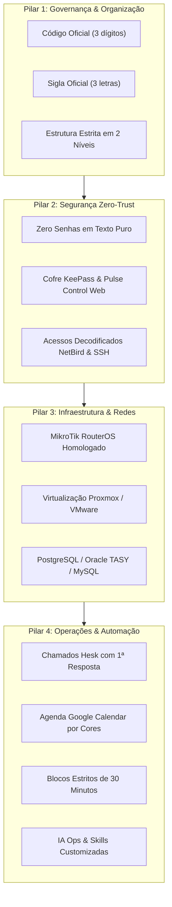

# 📖 Manual do Analista de Redes & Engenheiro de Infraestrutura N3

> **"Uma infraestrutura bem projetada não precisa ser heroica: ela opera com precisão, documentação militar, governança estrita e alta disponibilidade."**  
> — *Eduardo Pires, Analista de Redes N3*

---

## 🎯 Apresentação

Bem-vindo ao **Profissão: Analista de Redes & Engenheiro de Infraestrutura N3**.

Este material consolida o conhecimento construído na linha de frente da gestão de TI como **Provedor de Serviços Gerenciados (MSP/MSSP)**. Aqui documentamos com profundidade técnica como desenhar, governar, proteger, auditar e automatizar ambientes corporativos heterogêneos.

---

## 📊 Métricas do Ecossistema Operacional Homologado

| Indicador | Valor Consolidado |
| :--- | :--- |
| **Clientes e Ambientes Simultâneos Catalogados** | **25 Clientes Corporativos** |
| **Categorias Estruturais de Governança por Cliente** | **6 Categorias Estritas (2 Níveis)** |
| **Topologia de Roteadores MikroTik Gerenciados** | RouterOS v6 e v7 (RB750, RB3011, RB4011, CCRs e CHR) |
| **Sistemas de Gestão Hospitalar & ERPs** | Philips TASY, TOTVS Protheus, Optix PACS, Mobilemed |
| **Estratégia de Backup Homologada** | Regra 3-2-1-1-0 com Rotação GFS (Google Drive, S3, Wasabi) |
| **Sistemas de Monitoramento & Observabilidade** | Zabbix Enterprise 6/7, Beszel Hub e Grafana |
| **Central de Chamados e ITIL** | Hesk Helpdesk integrado via API REST |
| **Gestão de Tempo e Atividades** | Blocos Redondos de 30 Minutos & Google Calendar por Cores |

---

## 🏛️ Os Pilares da Governança Pulse TI

---

## 📌 Navegação Recomendada

- Para entender a transição de mentalidade entre suporte comum e engenharia MSP, comece pelo [Módulo 01: Fundamentos & Mentalidade MSP](01-fundamentos/01-mentalidade-msp.md).
- Para implementar o padrão de taxonomia de pastas e arquivos adotado nos clientes, consulte o [Módulo 02: Governança & Arquitetura de Workspace](02-governanca-organizacao/01-taxonomia-clientes.md).
- Para configurar roteadores MikroTik conforme o padrão de segurança e VPNs do nosso NOC, veja o [Módulo 04: Engenharia Avançada MikroTik RouterOS](04-redes-mikrotik/01-routeros-hardening.md).
- Para compreender as rotinas de backup multi-nuvem e proteção de bancos de missão crítica, estude o [Módulo 07: Backup Estratégico & DRP](07-backup-disaster-recovery/01-estrategia-321-gfs.md).
